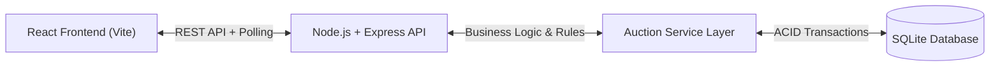
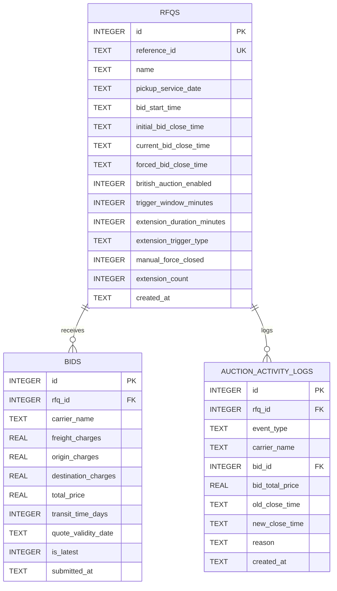

# British Auction in RFQ System

A simplified RFQ (Request for Quotation) system supporting British Reverse Auction bidding with automatic bid-time extensions, forced close rules, and real-time supplier rankings.

---

## 1. Simple HLD with Architecture Diagram

### System Architecture



### Text Architecture
```text
+-------------------------+      HTTP / REST      +-------------------------+
|  React Frontend (Vite)  | <-------------------> | Node.js + Express API   |
|  - Auction Listing      |   (JSON + 4s Poll)    | - /api/rfqs endpoints   |
|  - Create RFQ Page      |                       | - Error Middleware      |
|  - Auction Details      |                       +------------+------------+
+-------------------------+                                    |
                                                               v
                                                  +-------------------------+
                                                  | Auction Service Layer   |
                                                  | - Ranking (L1, L2, L3)  |
                                                  | - Trigger & Extensions  |
                                                  | - Forced Close Cap      |
                                                  +------------+------------+
                                                               |
                                                               v
                                                  +-------------------------+
                                                  | SQLite Database         |
                                                  | - rfqs, bids, logs      |
                                                  +-------------------------+
```

### Component Overview
- **Frontend (React + Vite):** 
  - **Auction Listing Page:** Displays active, upcoming, closed, and force-closed auctions with current lowest bids and deadlines.
  - **Create RFQ Page:** Form to set up an RFQ with British Auction rules ($X$ trigger window, $Y$ extension duration, and trigger conditions).
  - **Auction Details Page:** Live 1-second countdown timer, real-time supplier leaderboard ($L1, L2, L3\dots$), quote submission form, and chronological activity log.
- **Backend (Node.js + Express):**
  - RESTful API routes under `/api/rfqs`.
  - Global error handling middleware returning standardized JSON responses.
- **Auction Service Layer:**
  - Enforces auction state transitions (`Upcoming`, `Active`, `Closed`, `Force Closed`).
  - Evaluates trigger conditions (`BID_RECEIVED`, `ANY_RANK_CHANGE`, `L1_RANK_CHANGE`) within the trigger window ($X$).
  - Calculates extensions ($+Y$ minutes) while strictly enforcing the `Forced Bid Close Time` ceiling.
  - Sorts active quotes by `total_price ASC` and breaks ties using earlier submission timestamp.
- **Database (SQLite via `better-sqlite3`):**
  - Thread-safe write transactions via `db.transaction(...)` to prevent race conditions during concurrent bid submissions.

---

## 2. Schema Design for Database Tables

### Entity-Relationship Diagram



### Table Summary
1. **`rfqs`**: Stores RFQ schedule, British Auction parameters ($X$ trigger window, $Y$ extension duration, trigger rule), and mutable `current_bid_close_time`.
2. **`bids`**: Stores all submitted carrier quotes with charges breakdown (`freight + origin + destination = total_price`). The `is_latest = 1` flag tracks the supplier's active bid for the leaderboard while preserving historical bids.
3. **`auction_activity_logs`**: Audit trail capturing RFQ creation, quote submissions, time extensions (with old/new times and reasons), and manual closures.

### Indexes
- `idx_bids_rfq_latest` on `bids(rfq_id, is_latest, total_price)`
- `idx_logs_rfq_created` on `auction_activity_logs(rfq_id, created_at)`

---

## 3. Backend Code

The backend is written in **Node.js** with **Express** and **SQLite** (`better-sqlite3`).

### Key Files (`backend/`)
- `server.js` - Server setup, CORS, JSON parsing, error middleware
- `routes/rfqRoutes.js` - REST API routes for RFQ listing, creation, bidding, and force-closing
- `services/auctionService.js` - Core auction engine (ranking, trigger checks, extension math, forced-close cap)
- `db.js` - SQLite connection, schema creation, and initial seed data
- `tests/auction.test.js` - Automated test suite

### How to Run
```bash
cd backend
npm install
npm start
```
Server runs at `http://localhost:8000`.

### Run Tests
```bash
cd backend
npm test
```

---

## 4. Frontend Code

The frontend is built with **React** and **Vite**.

### Key Files (`frontend/`)
- `src/pages/AuctionListPage.jsx` - Auction table with statuses, lowest bids, and filters
- `src/pages/CreateRfqPage.jsx` - RFQ creation form with schedule and British Auction settings
- `src/pages/AuctionDetailsPage.jsx` - Real-time countdown, L1/L2 leaderboard, quote form, and activity log
- `src/api.js` - Centralized API client functions
- `src/utils/time.js` - Date formatting and live countdown calculations

### How to Run
```bash
cd frontend
npm install
npm run dev
```
Application runs at `http://localhost:5173`.
