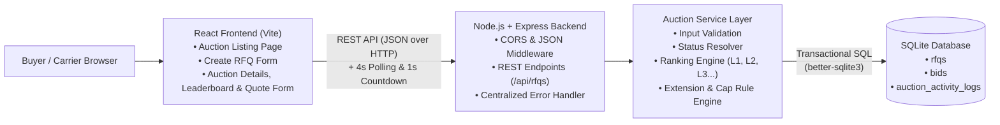
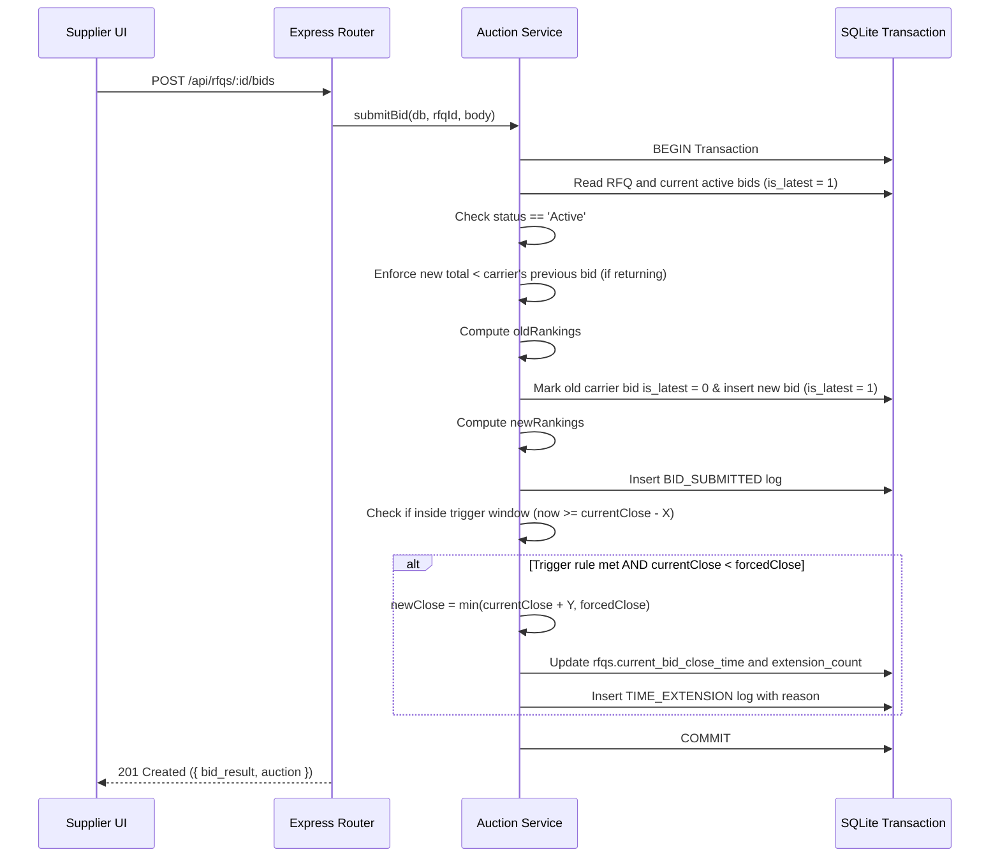
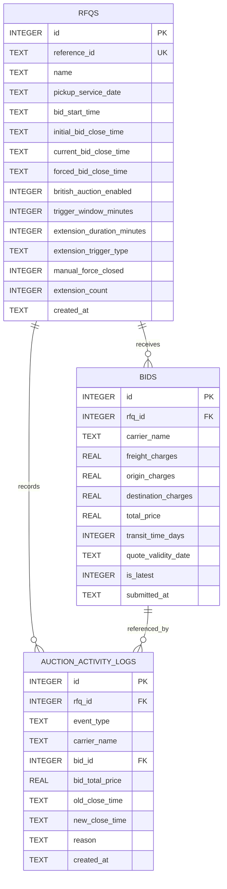

# British Auction in RFQ System

A full-stack Request for Quotation (RFQ) web application supporting **British Reverse Auction** bidding with automatic bid-time extensions, forced close time ceilings, dynamic supplier rankings (`L1, L2, L3...`), and an audit trail.

---

## 1. Project Overview & Summary

In logistics procurement, an **RFQ (Request for Quotation)** allows buyers to invite multiple carriers/suppliers to submit rate quotes for freight services. A **British Reverse Auction** is a competitive procurement process where:
- Suppliers submit competitive quotes openly.
- Suppliers can continuously lower their rates to improve their rank.
- If bidding activity occurs close to the auction end time (within a configured **Trigger Window $X$**), the auction deadline is **automatically extended** by **$Y$ minutes** to eliminate last-second sniping and encourage fair price discovery.
- The auction has a strict **Forced Bid Close Time** ceiling, after which bidding terminates unconditionally.

This implementation covers all 4 deliverables requested in the assignment:
1. **Simple HLD with Architecture Diagrams** (Mermaid + ASCII)
2. **Database Schema Design** (ER Diagram + SQL table definitions)
3. **Backend Code** (Node.js + Express + SQLite with transactional concurrency)
4. **Frontend Code** (React + Vite with live countdown, ranking leaderboard, and activity log)

---

## 2. High-Level Design (HLD)

### 2.1 Architecture Diagram



### 2.2 Text / ASCII Architecture
```text
+-----------------------------------------------------------------------+
|                         React Frontend (Vite)                         |
|   - Auction Listing Page (Statuses, Lowest Bids, Close Times)         |
|   - Create RFQ Page (Schedule, X/Y Config, Trigger Rule Selector)     |
|   - Auction Details Page (Live Timer, L1/L2 Leaderboard, Quote Form)  |
+-----------------------------------+-----------------------------------+
                                    |
                                    | HTTP / REST API (with 4s Polling)
                                    v
+-----------------------------------------------------------------------+
|                       Node.js + Express Backend                       |
|   - REST API Routes (/api/rfqs)                                       |
|   - Express JSON Middleware & Global Error Handler                    |
+-----------------------------------+-----------------------------------+
                                    |
                                    v
+-----------------------------------------------------------------------+
|                         Auction Service Layer                         |
|   - Status Evaluation (Upcoming, Active, Closed, Force Closed)        |
|   - Rank Sorter (L1, L2, L3... by price, breaks ties by timestamp)   |
|   - Anti-Sniping Trigger Evaluator (BID_RECEIVED, RANK, L1_CHANGE)   |
|   - Forced Close Ceiling Enforcer (never extends past forced close)   |
+-----------------------------------+-----------------------------------+
                                    |
                                    | ACID Transactions (db.transaction)
                                    v
+-----------------------------------------------------------------------+
|                            SQLite Database                            |
|   - rfqs (Schedule, configuration, mutable current_bid_close_time)    |
|   - bids (Historical + active bids marked with is_latest)             |
|   - auction_activity_logs (Audit trail for bids, extensions, closes)  |
+-----------------------------------------------------------------------+
```

### 2.3 End-to-End Bid & Extension Sequence



---

## 3. Database Schema Design

### 3.1 Entity-Relationship Diagram



### 3.2 Table Definitions

#### `rfqs`
| Column | Type | Constraints | Description |
|---|---|---|---|
| `id` | `INTEGER` | `PRIMARY KEY AUTOINCREMENT` | Internal primary key |
| `reference_id` | `TEXT` | `NOT NULL UNIQUE` | Unique reference code (e.g. `RFQ-2026-101`) |
| `name` | `TEXT` | `NOT NULL` | RFQ title / shipment lane |
| `pickup_service_date` | `TEXT` | `NOT NULL` | Scheduled pickup date (`YYYY-MM-DD`) |
| `bid_start_time` | `TEXT` | `NOT NULL` | UTC ISO-8601 bidding start timestamp |
| `initial_bid_close_time` | `TEXT` | `NOT NULL` | Original bid close timestamp |
| `current_bid_close_time` | `TEXT` | `NOT NULL` | Active bid close timestamp (updated on extension) |
| `forced_bid_close_time` | `TEXT` | `NOT NULL` | Hard deadline ceiling (must be `> bid_close_time`) |
| `british_auction_enabled` | `INTEGER` | `NOT NULL DEFAULT 1` | `1` = British Auction enabled, `0` = Standard RFQ |
| `trigger_window_minutes` | `INTEGER` | `NOT NULL DEFAULT 10` | $X$ minutes before close to monitor activity |
| `extension_duration_minutes` | `INTEGER` | `NOT NULL DEFAULT 5` | $Y$ minutes added when triggered |
| `extension_trigger_type` | `TEXT` | `CHECK IN ('BID_RECEIVED', 'ANY_RANK_CHANGE', 'L1_RANK_CHANGE')` | Trigger condition |
| `manual_force_closed` | `INTEGER` | `NOT NULL DEFAULT 0` | `1` if manually force-closed by buyer |
| `extension_count` | `INTEGER` | `NOT NULL DEFAULT 0` | Total number of auto-extensions applied |
| `created_at` | `TEXT` | `NOT NULL` | Timestamp of RFQ creation |

#### `bids`
| Column | Type | Constraints | Description |
|---|---|---|---|
| `id` | `INTEGER` | `PRIMARY KEY AUTOINCREMENT` | Bid ID |
| `rfq_id` | `INTEGER` | `NOT NULL REFERENCES rfqs(id)` | Parent RFQ |
| `carrier_name` | `TEXT` | `NOT NULL` | Carrier/supplier name |
| `freight_charges` | `REAL` | `NOT NULL CHECK (>= 0)` | Base freight charge |
| `origin_charges` | `REAL` | `NOT NULL CHECK (>= 0)` | Origin terminal/handling charges |
| `destination_charges` | `REAL` | `NOT NULL CHECK (>= 0)` | Destination handling charges |
| `total_price` | `REAL` | `NOT NULL CHECK (> 0)` | Computed sum (`freight + origin + destination`) |
| `transit_time_days` | `INTEGER` | `NOT NULL CHECK (>= 1)` | Transit time in days |
| `quote_validity_date` | `TEXT` | `NOT NULL` | Expiration date of quote |
| `is_latest` | `INTEGER` | `NOT NULL DEFAULT 1` | `1` = active bid on leaderboard, `0` = superseded |
| `submitted_at` | `TEXT` | `NOT NULL` | UTC ISO-8601 submission timestamp |

#### `auction_activity_logs`
| Column | Type | Constraints | Description |
|---|---|---|---|
| `id` | `INTEGER` | `PRIMARY KEY AUTOINCREMENT` | Log ID |
| `rfq_id` | `INTEGER` | `NOT NULL REFERENCES rfqs(id)` | Parent RFQ |
| `event_type` | `TEXT` | `CHECK IN ('AUCTION_CREATED', 'BID_SUBMITTED', 'TIME_EXTENSION', 'AUCTION_FORCE_CLOSED')` | Event type |
| `carrier_name` | `TEXT` | `NULL` | Carrier involved (if applicable) |
| `bid_id` | `INTEGER` | `NULL REFERENCES bids(id)` | Referenced bid |
| `bid_total_price` | `REAL` | `NULL` | Bid amount at event |
| `old_close_time` | `TEXT` | `NULL` | Close timestamp before extension |
| `new_close_time` | `TEXT` | `NULL` | Close timestamp after extension |
| `reason` | `TEXT` | `NOT NULL` | Human-readable explanation |
| `created_at` | `TEXT` | `NOT NULL` | Event timestamp |

### 3.3 Database Indexes
- `idx_bids_rfq_latest` on `bids(rfq_id, is_latest, total_price)`: Accelerates live leaderboard sorting.
- `idx_logs_rfq_created` on `auction_activity_logs(rfq_id, created_at)`: Accelerates activity log queries.

---

## 4. Core Features & Business Rules

1. **RFQ Creation & Validation:**
   - Enforces `Bid Close Time > Bid Start Time`.
   - Enforces `Forced Bid Close Time > Bid Close Time`.
   - Configurable Trigger Window ($X$) and Extension Duration ($Y$).
2. **Reverse Auction Mechanics & Ranking:**
   - Suppliers can bid multiple times, but each subsequent quote must be **strictly lower** than their own previous active quote.
   - Leaderboard ranks active suppliers (`L1, L2, L3...`) by `total_price ASC`.
   - Ties in price are broken deterministically by earlier `submitted_at` timestamp.
3. **Extension Triggers (Section 6.3):**
   - **`BID_RECEIVED`:** Any valid bid submitted in the last $X$ minutes extends close time by $Y$ minutes.
   - **`ANY_RANK_CHANGE`:** Extends only if any supplier's rank position shifts.
   - **`L1_RANK_CHANGE`:** Extends only if the lowest bidder ($L1$) changes.
4. **Forced Close Time Cap:**
   - Auto-extensions are calculated as `Math.min(currentClose + Y, forcedClose)`.
   - The close time **never exceeds** the `Forced Bid Close Time`.
5. **Auction Lifecycle Statuses:**
   - **`Upcoming`**: `now < bid_start_time` (bidding blocked).
   - **`Active`**: `bid_start_time <= now < current_bid_close_time` (bidding open).
   - **`Closed`**: Auction reached its scheduled close time naturally before reaching Forced Close Time.
   - **`Force Closed`**: Closed manually by buyer, or closed after auto-extensions reached the Forced Close Time ceiling.

---

## 5. How to Run Locally

### Prerequisites
- Node.js (v18+ recommended)
- npm

### Step 1: Start the Backend (Port `8000`)
```bash
cd backend
npm install
npm start
```
- API server runs at: `http://localhost:8000`
- Health check: `http://localhost:8000/api/health`

### Step 2: Start the Frontend (Port `5173`)
Open a second terminal:
```bash
cd frontend
npm install
npm run dev
```
- Open your browser at: `http://localhost:5173`

### Step 3: Run Automated Tests
```bash
cd backend
npm test
```
Runs 6 automated tests using Node's built-in test runner covering validation, all 3 trigger rules, Forced Close capping, and HTTP API integration.

---

## 6. Quick Demo Walkthrough

On first startup, the backend automatically seeds 4 sample RFQs relative to the current time:

1. **`RFQ-2026-101` (`Active`)**: Closes in ~7 minutes with a 10-minute Trigger Window (`BID_RECEIVED`), so it is already inside its trigger window. Submitting any lower quote immediately extends the auction by +5 minutes and logs the extension reason.
2. **`RFQ-2026-102` (`Active`)**: Uses `L1_RANK_CHANGE` with a tight Forced Close ceiling (+11 mins), demonstrating both L1-only extensions and capping at `Forced Bid Close Time`.
3. **`RFQ-2026-103` (`Closed`)**: Shows an auction that extended once and closed naturally before hitting Forced Close Time.
4. **`RFQ-2026-104` (`Force Closed`)**: Shows an auction that extended until it reached its `Forced Bid Close Time` ceiling.

Use **Reset Demo Data** on the Auction Listing page anytime to regenerate fresh demo timestamps.
