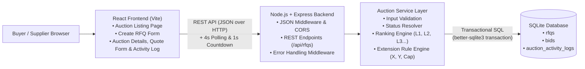
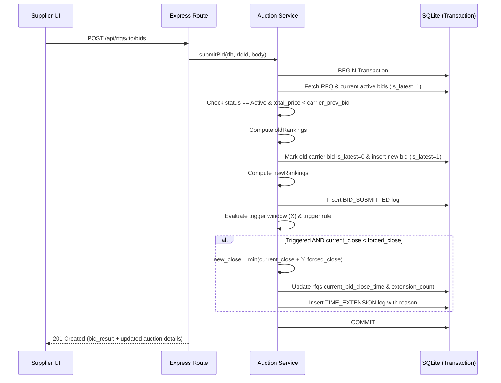

# High-Level Design (HLD) — British Auction in RFQ System

## 1. Overview

This system is a simplified **Request for Quotation (RFQ)** platform supporting **British Reverse Auction** bidding for freight/logistics procurement. Suppliers (carriers) submit competitive quotes openly and lower their prices over time. When bidding activity occurs close to the auction deadline, the system automatically extends the close time up to a strict **Forced Bid Close Time** ceiling.

---

## 2. Architecture Diagram



### Text / ASCII View
```text
+-----------------------------------+
|      React Frontend (Vite)        |
|  - Auction Listing Page           |
|  - Create RFQ + Config Form       |
|  - Auction Details & Live Timer   |
|  - Quote Submission & Log View    |
+-----------------+-----------------+
                  |  HTTP / JSON (REST API + 4s Polling)
                  v
+-----------------------------------+
|    Node.js + Express Backend      |
|  - REST Routes (/api/rfqs)        |
|  - Global Error Middleware        |
+-----------------+-----------------+
                  |
                  v
+-----------------------------------+
|      Auction Service Layer        |
|  - Validation & Status Check      |
|  - Ranking Engine (L1, L2, L3...) |
|  - Extension Trigger Evaluator    |
|  - Forced Close Cap Enforcer      |
+-----------------+-----------------+
                  |  SQLite Transactions
                  v
+-----------------------------------+
|         SQLite Database           |
|  - rfqs                           |
|  - bids                           |
|  - auction_activity_logs          |
+-----------------------------------+
```

---

## 3. Component Responsibilities

### 3.1 Frontend (React + Vite)
- **Auction Listing Page:** Displays all RFQs with RFQ Name/Reference ID, current lowest bid (`L1`), current bid close time, forced close time, and live status (`Active`, `Closed`, `Force Closed`, `Upcoming`).
- **Create RFQ Page:** Collects RFQ metadata, schedule times, and British Auction rules (`X` trigger window, `Y` extension duration, trigger condition) with client-side + server-side validation.
- **Auction Details Page:** Shows live countdown timer, auction rules, supplier ranking table (`L1, L2, L3...`) with full charge breakdowns, quote submission form, manual force-close action, and chronological activity log.
- **Live Sync:** Uses a 1-second local countdown timer combined with lightweight polling (every 4 seconds) on active auctions so multiple tabs stay synchronized cleanly.

### 3.2 Backend API (Node.js + Express)
- Exposes REST endpoints under `/api/rfqs` via Express Router (`routes/rfqRoutes.js`).
- Converts custom `AppError` exceptions into clean JSON HTTP responses (`400`, `404`, `409`).

### 3.3 Auction Service Layer (`services/auctionService.js`)
1. **Status Calculation (Time-driven + Manual Override):**
   - `Force Closed` if manually force-closed by buyer, OR if `british_auction_enabled` and `current_bid_close_time >= forced_bid_close_time` after expiry.
   - `Upcoming` if `now < bid_start_time`.
   - `Active` if `bid_start_time <= now < min(current_bid_close_time, forced_bid_close_time)`.
   - `Closed` otherwise.
2. **Bid & Ranking Logic:**
   - Total quote price = `freight_charges + origin_charges + destination_charges`.
   - A returning carrier must submit a total price strictly lower than their own previous active bid.
   - Rankings (`L1, L2, L3...`) are computed by sorting active supplier bids (`is_latest = 1`) by `total_price ASC, submitted_at ASC, id ASC` (earlier timestamp breaks ties).
3. **Extension Engine:**
   - Runs atomically inside `db.transaction(...)`.
   - Checks if `now` is within `[current_bid_close_time - X minutes, current_bid_close_time)`.
   - Evaluates the configured trigger rule:
     - `BID_RECEIVED`: Any valid bid submitted inside the window.
     - `ANY_RANK_CHANGE`: Any existing supplier's rank position changed (or first bidder entered).
     - `L1_RANK_CHANGE`: Lowest-priced supplier (`L1`) changed compared to before the bid.
   - Calculates `new_close = min(current_bid_close_time + Y minutes, forced_bid_close_time)`.
   - Updates `current_bid_close_time` only if `new_close > current_bid_close_time` and records a `TIME_EXTENSION` entry in `auction_activity_logs` with the exact reason.

---

## 4. End-to-End Bid & Auto-Extension Sequence



---

## 5. Future Scaling Notes
- **Database Migration:** The relational SQL schema maps directly to **PostgreSQL** (`SELECT ... FOR UPDATE` on the `rfqs` row to lock concurrent bids per auction).
- **Real-Time Push:** Polling can be upgraded to **WebSockets** or **Server-Sent Events (SSE)** for hundreds of concurrent suppliers on a single RFQ.
