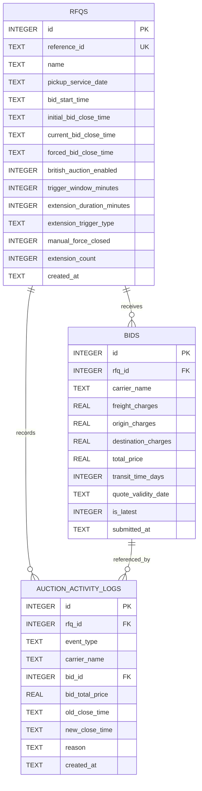

# Database Schema Design — British Auction in RFQ System

## 1. Entity-Relationship Diagram



---

## 2. Table Definitions

### 2.1 `rfqs`
Stores each RFQ's core schedule, British Auction configuration (`X`, `Y`, trigger rule), and mutable close time as extensions occur.

| Column | Type | Constraints | Description |
|---|---|---|---|
| `id` | `INTEGER` | `PRIMARY KEY AUTOINCREMENT` | Internal unique RFQ identifier |
| `reference_id` | `TEXT` | `NOT NULL UNIQUE` | Business Reference ID (e.g., `RFQ-2026-101`) |
| `name` | `TEXT` | `NOT NULL` | RFQ title / lane description |
| `pickup_service_date` | `TEXT` | `NOT NULL` | Scheduled pickup/service date (`YYYY-MM-DD`) |
| `bid_start_time` | `TEXT` | `NOT NULL` | UTC ISO-8601 auction start timestamp |
| `initial_bid_close_time` | `TEXT` | `NOT NULL` | Original bid close timestamp before extensions |
| `current_bid_close_time` | `TEXT` | `NOT NULL` | Active bid close timestamp (updated on extension) |
| `forced_bid_close_time` | `TEXT` | `NOT NULL` | Hard close ceiling (`> initial_bid_close_time`) |
| `british_auction_enabled` | `INTEGER` | `NOT NULL DEFAULT 1` | `1` = British Auction rules active, `0` = standard RFQ |
| `trigger_window_minutes` | `INTEGER` | `NOT NULL DEFAULT 10` | `X` minutes before close time to monitor activity |
| `extension_duration_minutes` | `INTEGER` | `NOT NULL DEFAULT 5` | `Y` minutes added when triggered |
| `extension_trigger_type` | `TEXT` | `NOT NULL CHECK (...)` | `'BID_RECEIVED'`, `'ANY_RANK_CHANGE'`, or `'L1_RANK_CHANGE'` |
| `manual_force_closed` | `INTEGER` | `NOT NULL DEFAULT 0` | `1` if manually force-closed by buyer |
| `extension_count` | `INTEGER` | `NOT NULL DEFAULT 0` | Number of automatic extensions applied |
| `created_at` | `TEXT` | `NOT NULL` | Creation timestamp (UTC ISO-8601) |

### 2.2 `bids`
Stores every quote submitted by carriers/suppliers. Historical bids from the same carrier are preserved with `is_latest = 0`, while the carrier's current active bid has `is_latest = 1`.

| Column | Type | Constraints | Description |
|---|---|---|---|
| `id` | `INTEGER` | `PRIMARY KEY AUTOINCREMENT` | Unique bid ID |
| `rfq_id` | `INTEGER` | `NOT NULL REFERENCES rfqs(id) ON DELETE CASCADE` | Parent RFQ |
| `carrier_name` | `TEXT` | `NOT NULL` | Name of carrier/supplier submitting quote |
| `freight_charges` | `REAL` | `NOT NULL CHECK (freight_charges >= 0)` | Base freight cost |
| `origin_charges` | `REAL` | `NOT NULL CHECK (origin_charges >= 0)` | Origin handling cost |
| `destination_charges` | `REAL` | `NOT NULL CHECK (destination_charges >= 0)` | Destination handling cost |
| `total_price` | `REAL` | `NOT NULL CHECK (total_price > 0)` | Sum of freight + origin + destination |
| `transit_time_days` | `INTEGER` | `NOT NULL CHECK (transit_time_days >= 1)` | Estimated transit duration in days |
| `quote_validity_date` | `TEXT` | `NOT NULL` | Quote expiration date (`YYYY-MM-DD`) |
| `is_latest` | `INTEGER` | `NOT NULL DEFAULT 1` | `1` = active bid for leaderboard (`L1, L2...`), `0` = superseded |
| `submitted_at` | `TEXT` | `NOT NULL` | Submission timestamp (UTC ISO-8601) |

### 2.3 `auction_activity_logs`
Immutable audit trail capturing RFQ creation, every bid submission, every time extension (including old/new close times and reason), and manual force closures.

| Column | Type | Constraints | Description |
|---|---|---|---|
| `id` | `INTEGER` | `PRIMARY KEY AUTOINCREMENT` | Unique log entry ID |
| `rfq_id` | `INTEGER` | `NOT NULL REFERENCES rfqs(id) ON DELETE CASCADE` | Parent RFQ |
| `event_type` | `TEXT` | `NOT NULL CHECK (...)` | `'AUCTION_CREATED'`, `'BID_SUBMITTED'`, `'TIME_EXTENSION'`, `'AUCTION_FORCE_CLOSED'` |
| `carrier_name` | `TEXT` | `NULL` | Carrier involved (if applicable) |
| `bid_id` | `INTEGER` | `NULL REFERENCES bids(id) ON DELETE SET NULL` | Related bid row (if applicable) |
| `bid_total_price` | `REAL` | `NULL` | Quote total at time of event |
| `old_close_time` | `TEXT` | `NULL` | Close time before extension |
| `new_close_time` | `TEXT` | `NULL` | Close time after extension |
| `reason` | `TEXT` | `NOT NULL` | Human-readable explanation of event/extension |
| `created_at` | `TEXT` | `NOT NULL` | Event timestamp (UTC ISO-8601) |

---

## 3. SQL Schema Script

```sql
CREATE TABLE IF NOT EXISTS rfqs (
  id INTEGER PRIMARY KEY AUTOINCREMENT,
  reference_id TEXT NOT NULL UNIQUE,
  name TEXT NOT NULL,
  pickup_service_date TEXT NOT NULL,
  bid_start_time TEXT NOT NULL,
  initial_bid_close_time TEXT NOT NULL,
  current_bid_close_time TEXT NOT NULL,
  forced_bid_close_time TEXT NOT NULL,
  british_auction_enabled INTEGER NOT NULL DEFAULT 1,
  trigger_window_minutes INTEGER NOT NULL DEFAULT 10,
  extension_duration_minutes INTEGER NOT NULL DEFAULT 5,
  extension_trigger_type TEXT NOT NULL DEFAULT 'BID_RECEIVED'
    CHECK (extension_trigger_type IN ('BID_RECEIVED', 'ANY_RANK_CHANGE', 'L1_RANK_CHANGE')),
  manual_force_closed INTEGER NOT NULL DEFAULT 0,
  extension_count INTEGER NOT NULL DEFAULT 0,
  created_at TEXT NOT NULL
);

CREATE TABLE IF NOT EXISTS bids (
  id INTEGER PRIMARY KEY AUTOINCREMENT,
  rfq_id INTEGER NOT NULL,
  carrier_name TEXT NOT NULL,
  freight_charges REAL NOT NULL CHECK (freight_charges >= 0),
  origin_charges REAL NOT NULL CHECK (origin_charges >= 0),
  destination_charges REAL NOT NULL CHECK (destination_charges >= 0),
  total_price REAL NOT NULL CHECK (total_price > 0),
  transit_time_days INTEGER NOT NULL CHECK (transit_time_days >= 1),
  quote_validity_date TEXT NOT NULL,
  is_latest INTEGER NOT NULL DEFAULT 1,
  submitted_at TEXT NOT NULL,
  FOREIGN KEY (rfq_id) REFERENCES rfqs(id) ON DELETE CASCADE
);

CREATE TABLE IF NOT EXISTS auction_activity_logs (
  id INTEGER PRIMARY KEY AUTOINCREMENT,
  rfq_id INTEGER NOT NULL,
  event_type TEXT NOT NULL
    CHECK (event_type IN ('AUCTION_CREATED', 'BID_SUBMITTED', 'TIME_EXTENSION', 'AUCTION_FORCE_CLOSED')),
  carrier_name TEXT,
  bid_id INTEGER,
  bid_total_price REAL,
  old_close_time TEXT,
  new_close_time TEXT,
  reason TEXT NOT NULL,
  created_at TEXT NOT NULL,
  FOREIGN KEY (rfq_id) REFERENCES rfqs(id) ON DELETE CASCADE,
  FOREIGN KEY (bid_id) REFERENCES bids(id) ON DELETE SET NULL
);

CREATE INDEX IF NOT EXISTS idx_bids_rfq_latest
  ON bids(rfq_id, is_latest, total_price);

CREATE INDEX IF NOT EXISTS idx_logs_rfq_created
  ON auction_activity_logs(rfq_id, created_at);
```

> **Note for PostgreSQL:** The same schema translates directly to PostgreSQL by replacing `INTEGER PRIMARY KEY AUTOINCREMENT` with `SERIAL PRIMARY KEY`, `REAL` with `NUMERIC(12, 2)`, `INTEGER` booleans with `BOOLEAN`, and `TEXT` timestamps with `TIMESTAMPTZ`.

---

## 4. Key Design Decisions
1. **`initial_bid_close_time` vs `current_bid_close_time`:** Storing both lets the UI show how much an auction has been extended compared to its original deadline while enforcing `current_bid_close_time <= forced_bid_close_time`.
2. **`is_latest` Flag on `bids`:** Keeps the live ranking query fast (`WHERE rfq_id = ? AND is_latest = 1 ORDER BY total_price ASC`) while preserving every historical bid reduction for auditing.
3. **Dedicated `auction_activity_logs` Table:** Separates audit events from raw bid rows so both bid submissions and close-time extensions (with exact old/new timestamps and trigger reasons) render cleanly on a unified timeline.

